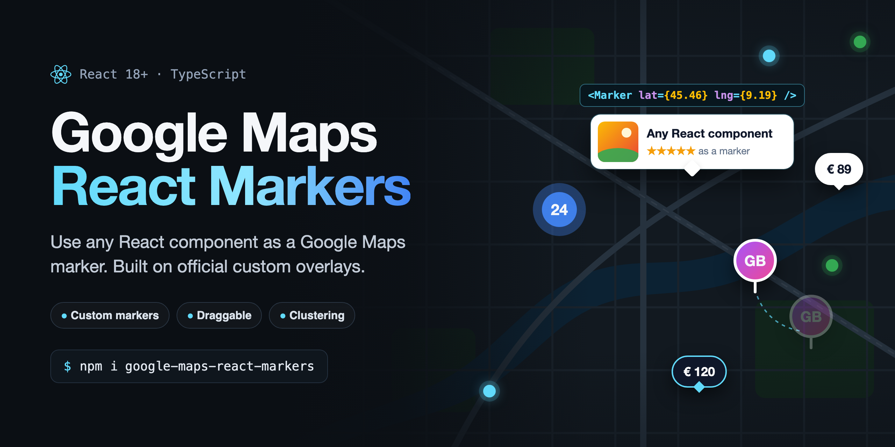

<p align="center">

</p>

<p align="center">
<a href="https://www.npmjs.com/package/google-maps-react-markers" target="_blank">

</a>
<a href="https://npm-stat.com/charts.html?package=google-maps-react-markers" target="_blank">

</a>

<a href="https://github.com/giorgiabosello/google-maps-react-markers/blob/master/LICENCE.md" target="_blank">

</a>

<a href="https://github.com/giorgiabosello/google-maps-react-markers/issues" target="_blank">

</a>
<a href="https://makeapullrequest.com/">

</a>
</p>

Google Maps library that accepts markers as react components and works with React 18+.

It supports a small set of the props of [Google Map React](https://github.com/google-map-react/google-map-react). Clustering also is possible.
The library implements [Google Maps Custom Overlays](https://developers.google.com/maps/documentation/javascript/customoverlays) official library.

**If you like this library, please consider supporting me ❤️**

[](https://www.buymeacoffee.com/giorgiabosello)
[](https://www.paypal.me/giorgiabosello)

## 💬 Discussion

> **Released TypeScript version of the library!**

Feedbacks are welcome in [this discussion](https://github.com/giorgiabosello/google-maps-react-markers/discussions/109).

## 🚀 Demo

<a href="https://giorgiabosello.github.io/google-maps-react-markers/" target="blank">

</a>

See it in action [here](https://giorgiabosello.github.io/google-maps-react-markers/) _(API KEY not provided)_.

Demo source code is available [here](https://github.com/giorgiabosello/google-maps-react-markers/tree/master/docs/src).

## 🛠 Install

```bash
pnpm add google-maps-react-markers
```

or

```bash
yarn add google-maps-react-markers
```

or

```bash
npm install --save google-maps-react-markers
```

## 💻 Usage

```jsx
import GoogleMap from 'google-maps-react-markers'

const App = () => {
  const mapRef = useRef(null)
  const [mapReady, setMapReady] = useState(false)

  /**
   * @description This function is called when the map is ready
   * @param {Object} map - reference to the map instance
   * @param {Object} maps - reference to the maps library
   */
  const onGoogleApiLoaded = ({ map, maps }) => {
    mapRef.current = map
    setMapReady(true)
  }

  const onMarkerClick = (e, { markerId, lat, lng }) => {
    console.log('This is ->', markerId)

    // inside the map instance you can call any google maps method
    mapRef.current.setCenter({ lat, lng })
    // ref. https://developers.google.com/maps/documentation/javascript/reference?hl=it
  }

  return (
    <>
      {mapReady && <div>Map is ready. See for logs in developer console.</div>}
      <GoogleMap
        apiKey=""
        defaultCenter={{ lat: 45.4046987, lng: 12.2472504 }}
        defaultZoom={5}
        options={mapOptions}
        mapMinHeight="100vh"
        onGoogleApiLoaded={onGoogleApiLoaded}
        onChange={(map) => console.log('Map moved', map)}
      >
        {coordinates.map(({ lat, lng, name }, index) => (
          <Marker
            key={index}
            lat={lat}
            lng={lng}
            markerId={name}
            onClick={onMarkerClick} // you need to manage this prop on your Marker component!
            // draggable={true}
            // onDragStart={(e, { latLng }) => {}}
            // onDrag={(e, { latLng }) => {}}
            // onDragEnd={(e, { latLng }) => {}}
          />
        ))}
      </GoogleMap>
    </>
  )
}

export default App
```

## 🧐 Props

### GoogleMap component

| Prop                                | Type     | Required | Default                     | Description                                                                                                                                                                                                                                                                                                                                                                                                                           |
| ----------------------------------- | -------- | -------- | --------------------------- | ------------------------------------------------------------------------------------------------------------------------------------------------------------------------------------------------------------------------------------------------------------------------------------------------------------------------------------------------------------------------------------------------------------------------------------- |
| **apiKey**                          | string   | **yes**  | `''`                        | API Key to load Google Maps                                                                                                                                                                                                                                                                                                                                                                                                           |
| **defaultCenter**                   | object   | **yes**  | `{ lat: 0, lng: 0 }`        | Default center of the map. Not needed if you pass `center`                                                                                                                                                                                                                                                                                                                                                                            |
| **defaultZoom**                     | number   | **yes**  | `1-20`                      | Default zoom of the map. Not needed if you pass `zoom`                                                                                                                                                                                                                                                                                                                                                                                |
| center                              | object   | no       | `undefined`                 | Controlled center: when it changes, the map moves there. Keep it in sync with `onChange` (since 2.1.0)                                                                                                                                                                                                                                                                                                                                |
| zoom                                | number   | no       | `undefined`                 | Controlled zoom. Keep it in sync with `onChange` (since 2.1.0)                                                                                                                                                                                                                                                                                                                                                                        |
| libraries                           | array    | no       | `['places', 'geometry']`    | Libraries to load                                                                                                                                                                                                                                                                                                                                                                                                                     |
| options                             | object   | no       | `{}`                        | [Options](https://developers.google.com/maps/documentation/javascript/reference/map#MapOptions) for the map. Since 2.1.0, the options that change are applied with `map.setOptions()`                                                                                                                                                                                                                                                 |
| onGoogleApiLoaded                   | function | no       | `() => {}`                  | Callback when the map is loaded                                                                                                                                                                                                                                                                                                                                                                                                       |
| onChange                            | function | no       | `() => {}`                  | Callback when the map has changed. Receives `{ bounds, bbox, center, zoom }`: `bbox` is `[westLng, southLat, eastLng, northLat]` (since 2.1.0), `center` is `[lng, lat]`                                                                                                                                                                                                                                                              |
| onClick, onIdle, onZoomChanged, ... | function | no       | `undefined`                 | Google Maps events as props (since 2.1.0): `onBoundsChanged`, `onCenterChanged`, `onClick`, `onContextMenu`, `onDoubleClick`, `onDrag`, `onDragEnd`, `onDragStart`, `onHeadingChanged`, `onIdle`, `onMapTypeIdChanged`, `onMouseMove`, `onMouseOut`, `onMouseOver`, `onTilesLoaded`, `onTiltChanged`, `onZoomChanged`. Mouse events receive `(event, map)` and are not fired when they happen on a marker, the others receive `(map)` |
| events                              | array    | no       | `[]`                        | Array of objects name/handler of [DOM events](https://en.wikipedia.org/wiki/DOM_event) to pass down to the `div` overlay. Example: `events: [{ name: 'onClick', handler: () => {} }]`                                                                                                                                                                                                                                                 |
| children                            | node     | no       | `null`                      | Markers of the map: every child with `lat` and `lng`. Since 2.1.0, other children (`MapControl`, components that use `useMap()`) are rendered as they are                                                                                                                                                                                                                                                                             |
| loadScriptExternally                | bool     | no       | `false`                     | Whether to load the Google Maps script externally.<br>If `true`, the `status` prop is required and it will be used to control the loading of the script                                                                                                                                                                                                                                                                               |
| status                              | string   | no       | `idle`                      | The forced status of the Google Maps script. Depends on `loadScriptExternally`.<br>It can be one of `idle`, `loading`, `ready`, `error`                                                                                                                                                                                                                                                                                               |
| loadingContent                      | node     | no       | `'Google Maps is loading'`  | Content to show while the map is loading                                                                                                                                                                                                                                                                                                                                                                                              |
| idleContent                         | node     | no       | `'Google Maps is on idle'`  | Content to show when the map is idle                                                                                                                                                                                                                                                                                                                                                                                                  |
| errorContent                        | node     | no       | `'Google Maps is on error'` | Content to show when the map has an error                                                                                                                                                                                                                                                                                                                                                                                             |
| mapMinHeight                        | string   | no       | `'unset'`                   | Min height of the map                                                                                                                                                                                                                                                                                                                                                                                                                 |
| containerProps                      | object   | no       | `{}`                        | Props for the div container of the map                                                                                                                                                                                                                                                                                                                                                                                                |
| scriptCallback                      | function | no       | `() => {}`                  | window global callback passed to the Google Script                                                                                                                                                                                                                                                                                                                                                                                    |
| externalApiParams                   | object   | no       | `undefined`                 | Optional params to pass to the Google API script. Eg. `{region: 'IT', language: 'it'}`                                                                                                                                                                                                                                                                                                                                                |

### Markers

| Prop        | Type             | Required | Default     | Description                                                                                                                                                                                                                                               |
| ----------- | ---------------- | -------- | ----------- | --------------------------------------------------------------------------------------------------------------------------------------------------------------------------------------------------------------------------------------------------------- |
| **lat**     | number           | **yes**  | `undefined` | Latitude of the marker                                                                                                                                                                                                                                    |
| **lng**     | number           | **yes**  | `undefined` | Longitude of the marker                                                                                                                                                                                                                                   |
| anchor      | string or object | no       | `'center'`  | Which point of the marker sits on `lat`/`lng` (since 2.1.0): `'center'`, `'top'`, `'bottom'`, `'left'`, `'right'`, `'top-left'`, `'top-right'`, `'bottom-left'`, `'bottom-right'`, or `{ x, y }` as fractions of the marker size. Use `'bottom'` for pins |
| draggable   | bool             | no       | `false`     | If true, the marker can be dragged                                                                                                                                                                                                                        |
| onDragStart | func             | no       | `() => {}`  | This event is fired when the user starts dragging the marker                                                                                                                                                                                              |
| onDrag      | func             | no       | `() => {}`  | This event is repeatedly fired while the user drags the marker                                                                                                                                                                                            |
| onDragEnd   | func             | no       | `() => {}`  | This event is fired when the user stops dragging the marker                                                                                                                                                                                               |
| zIndex      | number           | no       | 0           | The z-index of the marker. To bring the marker to the front, e.g. when it is active, set a higher value.                                                                                                                                                  |

### Hooks and controls

Since 2.1.0, every child of `GoogleMap` without the `lat` and `lng` props is rendered as it is, in the map container but behind the map: it is not a marker, so position it yourself or put it in a `MapControl`. There you can use:

- `useMap()`: the `google.maps.Map` instance.
- `useMapsLibrary(name)`: loads a library with `google.maps.importLibrary()`, for example `useMapsLibrary('places')`. It returns `null` until the library is loaded.
- `MapControl`: renders its children as a native map control, in one of the [control positions](https://developers.google.com/maps/documentation/javascript/reference/control#ControlPosition).

They throw when used outside `GoogleMap`: there, use `onGoogleApiLoaded`.

```jsx
import GoogleMap, { MapControl, useMap } from 'google-maps-react-markers'

const RecenterButton = () => {
  const map = useMap()
  return <button onClick={() => map.panTo({ lat: 45.4046987, lng: 12.2472504 })}>Recenter</button>
}

const App = () => (
  <GoogleMap apiKey="" defaultCenter={{ lat: 45.4046987, lng: 12.2472504 }} defaultZoom={5}>
    <Pin lat={45.4046987} lng={12.2472504} anchor="bottom" />
    <MapControl position="TOP_RIGHT">
      <RecenterButton />
    </MapControl>
  </GoogleMap>
)
```

The TypeScript types use `@types/google.maps`, which is a dependency since 2.1.0. If your project has its own `@types/google.maps`, keep it on 3.58.1 or later, so npm installs a single copy.

## 📍 Clustering

For clustering, follow this [guide](https://www.leighhalliday.com/google-maps-clustering) using [useSupercluster Hook](https://github.com/leighhalliday/use-supercluster). Since 2.1.0, `onChange` gives you the bounds in the format supercluster expects:

```jsx
const [mapBounds, setMapBounds] = useState({
  bounds: [0, 0, 0, 0],
  zoom: 0,
})
// bbox is [westLng, southLat, eastLng, northLat]
const onMapChange = ({ bbox, zoom }) => setMapBounds({ bounds: bbox, zoom })

const { clusters, supercluster } = useSupercluster({
  points,
  bounds: mapBounds.bounds,
  zoom: mapBounds.zoom,
})
```

On 2.0.x, build it from `bounds`: `[sw.lng(), sw.lat(), ne.lng(), ne.lat()]`, with `const ne = bounds.getNorthEast()` and `const sw = bounds.getSouthWest()`.

## 👥 Contributing

To run the project locally, clone the repo and run:

```bash
# in the root directory
yarn --frozen-install
yarn dev
```

```bash
# in another tab (with NextJS and SSR)
cd docs
yarn install
yarn dev
```

Do your changes to `src/` or `docs/src` directory, commits all files in the root directory (`yarn.lock` and ones in `dist` too) and open a PR.

## 💻 Built with

- [React](https://reactjs.org/)
- [TypeScript](https://www.typescriptlang.org/)
- [Google Maps Custom Overlays](https://developers.google.com/maps/documentation/javascript/customoverlays)
- [tsup](https://github.com/egoist/tsup): for bundling
- [ESLint](https://eslint.org/): for linting
- [Prettier](https://prettier.io/): for code formatting

## 🗒 License

MIT © [giorgiabosello](https://github.com/giorgiabosello)

## 🙏 Support

[](https://www.buymeacoffee.com/giorgiabosello)
[](https://www.paypal.me/giorgiabosello)

<hr>
<p align="center">
Developed with ❤️ in Italy 🇮🇹 
</p>
